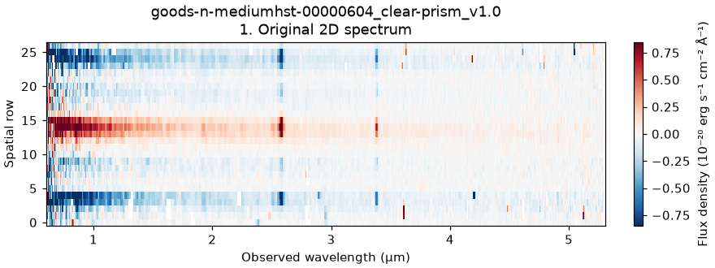

# JADES 2D to 1D Spectrum Extraction

This Python notebook extracts one-dimensional spectra from calibrated JWST/NIRSpec CLEAR/PRISM images and compares them with the published JADES spectra.

## Method

Each FITS image column represents a wavelength bin. Astropy reads the flux image and wavelength grid, and NumPy sums the spatial rows with `np.nansum(image, axis=0)`. The notebook checks that the wavelength grid matches the published 1D spectrum before calculating the root-mean-square error (RMSE). Matplotlib displays the 2D image, the extracted 1D spectrum, and the comparison as three separate plots for each of the first 15 targets in filename order.

## Results

The full-row sum was compared with the published spectrum for **3,752 matched pairs**. The median per-spectrum RMSE was **2.71 × 10⁻²⁰ erg s⁻¹ cm⁻² Å⁻¹**. Negative bands from background subtraction can reduce the flux when all rows are summed. In a separate check on the first 15 targets, summing the middle five rows improved the match for all 15 and lowered the median RMSE by a factor of about nine.

## Run the notebook

1. Download the [JADES CLEAR/PRISM archive](https://drive.google.com/file/d/1rpZSoMC-6rzwGjZtV2B2HhgUqj-m5QZR/view) from the [JADES data release](https://jades-survey.github.io/scientists/data.html).
2. In [Google Colab](https://colab.research.google.com/drive/1-L3NN1DscB1QbgjsxSdwaJ_2WfMDQp-y), place the archive in **My Drive**, run all cells, and approve the Drive mount when prompted.
3. To run locally, place the archive next to the [notebook](JADES%202D%20to%201D%20Spectrum.ipynb), install the dependencies with `python -m pip install astropy numpy matplotlib jupyterlab`, and launch JupyterLab from the repository root with `python -m jupyterlab`.

The [report](report/jades.pdf) for this work and its figures are in the `report` folder.
